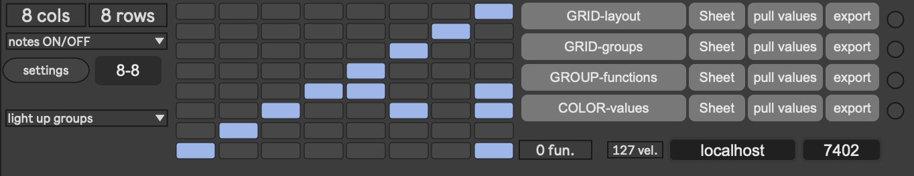

# meta_LED

This device controls any kind of led-frid, push-like, midi-capable devices

## Install

...

## Usage

...



## Automatic TesserPipe setup

In TesserLet, set the UDP data port and **PIPE MIDI output** (initially `APC Key 25`), then save the device/Live Set. Keep the UDP host at `localhost` for the local standalone Pipe. The MIDI name must match a MIDI output listed by standalone Max.

Click **open PIPE**. The existing shell command opens the saved `.maxpat` path in Max, reusing the running application. TesserLet reads the current saved fields, waits for TesserPipe, and applies its UDP port and MIDI output. The status reads `PIPE configured: UDP … → …` after TesserPipe acknowledges applying both settings. Invalid settings and missing MIDI devices produce a status message; a missing MIDI device leaves the receiver's existing settings unchanged.

Reload both updated patches once after installing this change. Keep `tesserpipe-launch.js` beside `meta_led.maxpat`, and `tesserpipe-config.js` in TesserPipe’s `code` folder (open its `.maxproj` so Max includes that folder); include these JavaScript dependencies when freezing/building a device. The launcher still requires the existing `shell` external.

Setup uses a separate local UDP request port **7410** and reply port **7411**, reserved independently of the MIDI data port. Requests retry every 500 ms for up to 30 seconds, with a request ID to ignore old replies. This setup endpoint configures one standalone TesserPipe; it does not create or address multiple independent Pipe instances. The acknowledgement confirms that settings were applied, not that a controller received a MIDI message; Max's console reports UDP bind errors.

Protocol tests (no Max or MIDI hardware required):

```sh
node tools/test-tesserpipe-config.cjs
```

## DMX4Live preset feedback

Route DMX4Live's MIDI output into TesserLet's MIDI input (for example, put
TesserLet after DMX4Live on the same MIDI device chain). In a separate receiving
Live track, use the appropriate MIDI routing and monitoring. The incoming
`midiin → midiparse → route 44 45` path handles:

- **CC 44:** occupied preset; turn its pad on using the saved highlight color.
- **CC 45:** empty preset; send velocity 0 to turn its pad off.
- The CC **value is preset number minus one**, not the pad's MIDI note number.

The saved APC setup uses the main **8 columns × 5 rows**, but this is a setting,
not a fixed device assumption. Set **COLS** and **ROWS** to match the playable
area of your controller. Presets always run left to right, top to bottom. The
layout dictionary supplies the actual MIDI note at each physical coordinate,
including nonsequential mappings and layouts with auxiliary buttons.

With 8×5 selected, values 0–39 address presets 1–40. Feedback for values 40–127
is retained without lighting a pad; it becomes visible if you expand the grid.
DMX4Live's full 128-slot snapshot is therefore safe for any supported grid size.
The following table is an APC example, not a hard-coded mapping:

| Preset | CC value | Physical position | APC MIDI note |
| --- | --- | --- | --- |
| 1 | 0 | Top-left | 32 |
| 8 | 7 | Top-right | 39 |
| 9 | 8 | Second row, left | 24 |
| 40 | 39 | Bottom-right | 7 |

For any saved grid size `C × R`, `column = value % C + 1` and
`live.grid row = R - floor(value / C)`. Max's grid numbers rows from the bottom;
the controller layout dictionary numbers rows from the top. Conversion happens
at the UI boundary. Grid dimensions come from the saved **COLS/ROWS** controls;
loading a 9×6 layout dictionary no longer silently enlarges an 8×5 playable bank.
Changing either dimension automatically turns off previously driven LEDs, clears
transient press/trigger state, resizes both grids, and redraws the cached preset
states using the new coordinates. These changes do not trigger preset selections
or group actions. Updates to both dimensions in one message chain are applied
together. A repeated identical dimension does not reset the current press state.
Physical buttons outside the chosen area are ignored rather than clamped onto
an edge cell. The optional playhead also follows the column count.

Max's `live.grid` has a native limit of **64 columns and 64 rows** (confirmed in
Max 9). The dimension controls therefore accept **1–64** per axis. The CC 44/45
protocol carries 128 identities (values 0–127), so it addresses the first
`min(COLS × ROWS, 128)` cells. Larger grids remain possible, but feedback for
cells beyond the first 128 would require an extended protocol. A grid layout
must also contain a valid MIDI note for each pad you want to light.

Each feedback packet sends an explicit LED state, including repeated values.
This lets **Sync LEDs** restore a controller after reconnection. Feedback is
separate from live press state and does not trigger presets or group functions.
Feedback is cached by zero-based preset number, including currently hidden
slots. It is remapped when dimensions change and replayed when the symbolic
layout finishes loading. A new layout clears old MIDI note targets before the
new lookup is used, so an old LED cannot be left lit by a changed mapping.
The trigger mode reads the same device-local highlight store when restoring the
previous pad's color. **clear highlights** clears both the overlay and cached
hardware highlights.

LED commands continue through the existing `NOTE <note> <velocity>` UDP stream
to standalone TesserPipe and its configured APC MIDI output. Open/configure PIPE,
then click DMX4Live's **Sync LEDs** after connecting the controller. The saved
highlight velocity is **5**; change **highlight-color** to use a different
controller-supported color. The dimension/state coordinator lives in
`meta_led/patchers/preset-grid-state.js`, beside `meta_led.maxpat`. It is listed
in the Max project and uses the explicit `Patcher:/` path inside an embedded
wrapper with fixed inlets/outlets. Include the script when freezing/exporting
the device; restore it and reload if it is missing.

State/coordinate tests (Node only):

```sh
node tools/test-preset-grid-state.cjs
```

Native regression test (isolated dictionaries and loopback UDP; no hardware
MIDI output, sheet downloads, or shell commands):

```sh
node tools/test-preset-feedback.native.cjs meta_led/patchers/meta_led.maxpat tesser_pipe/tesser_pipe/patchers/tesser_pipe.maxpat /tmp/tesser-feedback-test
```

Open `/tmp/tesser-feedback-test/feedback-test.maxpat` in Max, then run:

```sh
node tools/test-preset-feedback.native.cjs --verify /tmp/tesser-feedback-test
```

The test exercises raw CC bytes, all 40 pad mappings, full 128-slot snapshots,
repeated syncs, empty slots, out-of-range values, early feedback replay through
actual layout initialization, press-state isolation, trigger restoration, clear,
shrinking/growing grids, off-screen occupied and empty slots, 1×64 and 64×1
layouts, actual grid dimensions, physical-input bounds, preset numbering after
resize, and UDP → TesserPipe's NOTE decoder → MIDI parsing.
